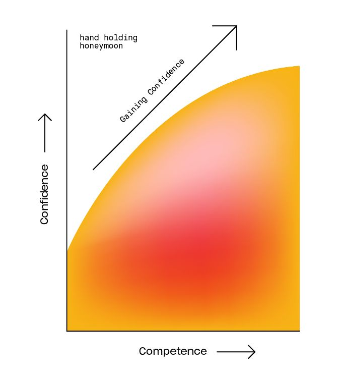
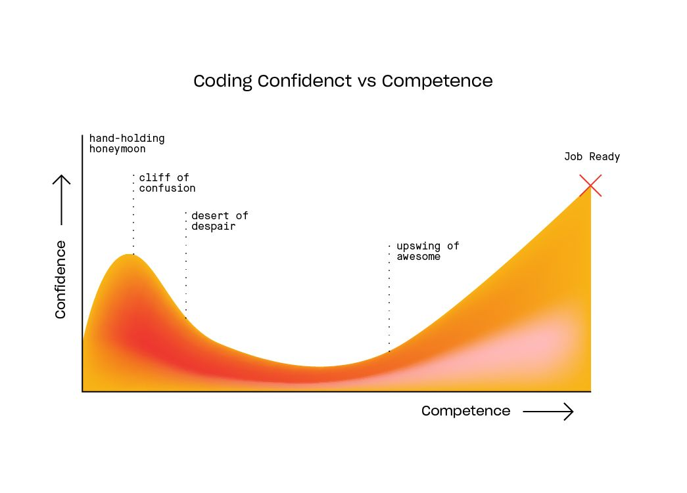
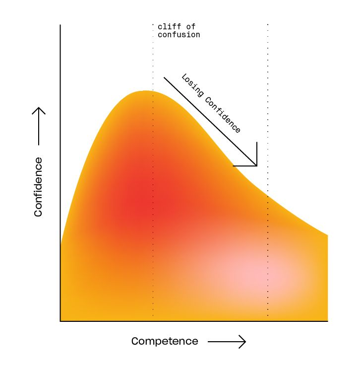
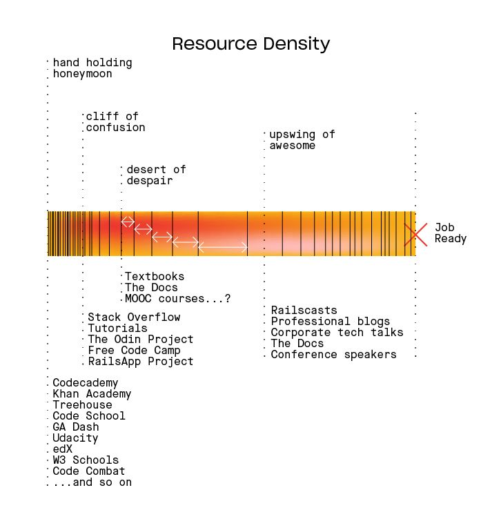
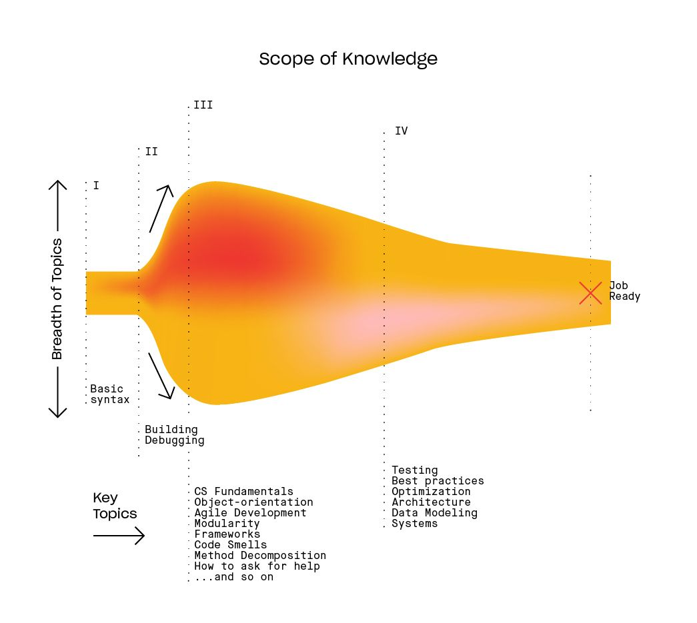
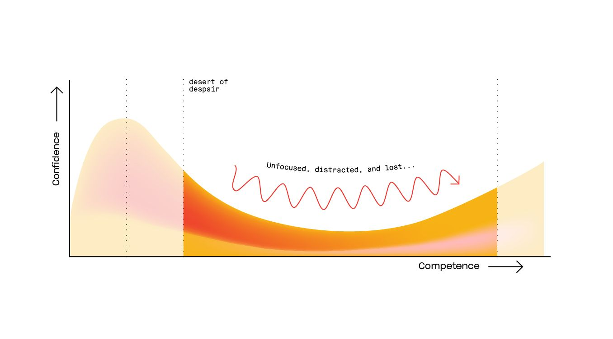
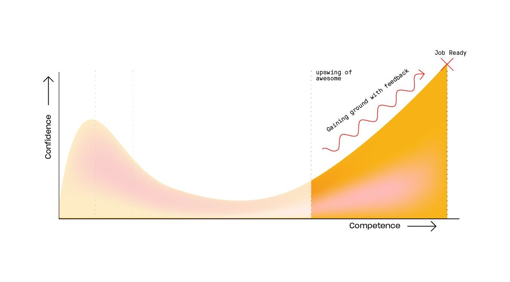
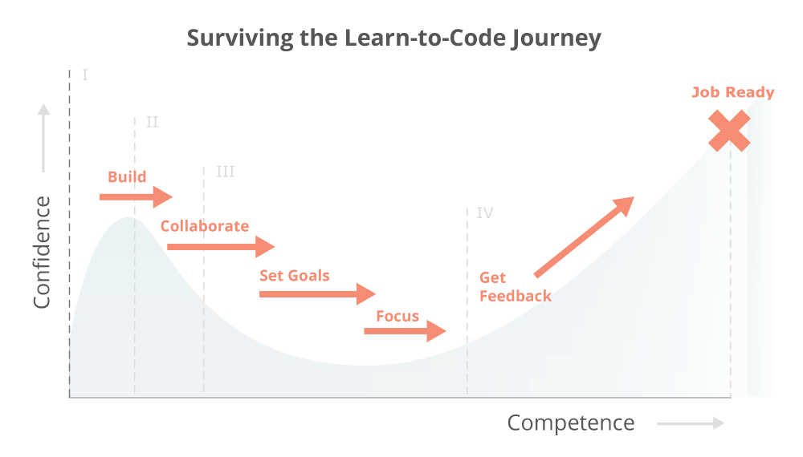
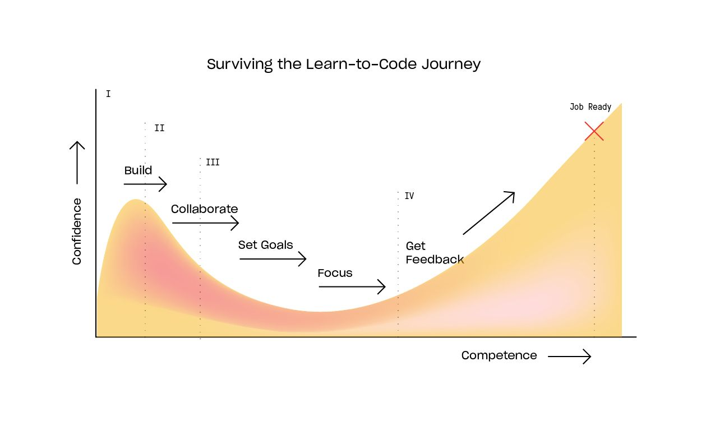

> Análise e resumo do artigo [Why Learning to Code is So Damn Hard](https://web.archive.org/web/20180413084800/http://www.vikingcodeschool.com:80/posts/why-learning-to-code-is-so-damn-hard), escrito por Erik Trautman para a Viking Code School (depois republicado no blog da Thinkful). O texto original saiu do ar e hoje só existe no [Internet Archive](https://web.archive.org/web/20240114143404/https://www.thinkful.com/blog/why-learning-to-code-is-so-damn-hard/). As imagens e os gráficos são os do artigo original, recuperados de cópias salvas no Internet Archive.

Esse é um dos textos que mais me marcaram sobre aprender a programar. Ele não ensina nenhuma linguagem nem ferramenta, mas explica por que a jornada parece tão confusa e por que tanta gente desiste no meio do caminho achando que o problema é ela mesma.

## O que todo iniciante precisa saber sobre a jornada que tem pela frente

Quincy Larson era apenas um “cara de terno trabalhando num escritório” quando decidiu que queria aprender a programar. Então começou a pedir conselhos. Primeiro aprendeu um pouco de Ruby, depois passou os olhos por outras linguagens, como Scala, Clojure e Go. Aprendeu Emacs, depois Vim e até o layout de teclado Dvorak. Conheceu Linux, experimentou Lisp e programou em Python, passando mais de meio ano praticamente vivendo na linha de comando.

Como uma folha no meio de um tornado, Quincy foi jogado de um lado para o outro pelos conselhos que recebia, até acabar fazendo “todos os cursos on-line imagináveis”. No fim, embora tenha conseguido [um emprego como desenvolvedor de software](http://web.archive.org/web/20230602160734/http://blog.freecodecamp.com/2014/11/a-cautionary-tale-of-learning-to-code.html), Quincy:

> ... estava convencido de que os programadores aparentemente normais que eu encontrava eram, na verdade, sociopatas que haviam passado pelo trauma de aprender a programar e depois reprimido essa experiência.

Essa doeu. Parece familiar?

### Fase I: A lua de mel de mãos dadas

É difícil culpar alguém por entrar no mundo da programação com expectativas absurdamente altas.

Por um lado, desde criança você ouve histórias sobre como programar é difícil, como aquelas histórias antigas contadas para assustar as crianças e fazê-las estudar ciências humanas.

Por outro, o movimento “Aprenda a Programar” fez um trabalho fantástico ao derrubar barreiras e mostrar que código não é nenhum bicho de sete cabeças. Ferramentas como Codecademy e Treehouse acolhem você com todo o cuidado, garantindo que você também (aliás, qualquer pessoa!) pode não apenas aprender a programar, mas se tornar um desenvolvedor de verdade.

De repente, o problema deixa de ser o medo e passa a ser o excesso de esperança e de expectativas.

E, em grande parte, essas ferramentas introdutórias fazem um ótimo trabalho ao conduzir você, como uma criança atravessando a rua de mãos dadas com um adulto, pelas assustadoras variáveis e estruturas condicionais e pelos primeiros conceitos de sintaxe. À medida que supera um desafio [gamificado](http://web.archive.org/web/20230602160734/https://en.wikipedia.org/wiki/Gamification) após o outro, sua confiança aumenta. Talvez você realmente consiga! Afinal, quão difícil pode ser? *Você já é praticamente um desenvolvedor!*

*A lua de mel de mãos dadas*

Mas aí está o problema: você está no que eu chamo de fase da “lua de mel de mãos dadas”. Embora pareça que a linha de chegada está logo ali, você percorreu apenas uma pequena fração do caminho. Isso é só o começo...

### Mapeando o caminho pela frente

Antes de mergulharmos na Fase II, vamos olhar para o panorama geral.

Neste artigo, vou apresentar as quatro fases da jornada típica de quem aprende a programar e o que você precisa fazer para sobreviver a cada uma delas. Você também verá como dois fatores fundamentais — a densidade de recursos e a abrangência do conhecimento necessário — definem essa jornada.

Podemos representar o caminho até estar preparado para o mercado de trabalho observando como o nível de confiança muda à medida que a capacidade aumenta:

Essa relação é importante porque sua confiança está fortemente ligada à sua felicidade. Além disso, o ponto em que confiança e capacidade se equilibram é a melhor aproximação que conheço para identificar o momento em que você está oficialmente “pronto para trabalhar”.

Logo veremos os desafios específicos das outras três fases, mas, essencialmente, cada uma envolve o seguinte:

1. **A lua de mel de mãos dadas** é um passeio divertido por recursos muito bem produzidos que ensinam coisas aparentemente complicadas, mas perfeitamente realizáveis com todo aquele apoio. Você aprende principalmente a sintaxe básica e se sente ótimo com suas conquistas.
2. **O precipício da confusão** é a descoberta dolorosa de que tudo fica muito mais difícil quando alguém deixa de segurar sua mão e você percebe que ainda não consegue fazer praticamente nada sozinho. Seus maiores desafios são depurar erros o tempo todo e não saber exatamente como fazer as perguntas certas enquanto luta para conseguir algum progresso.
3. **O deserto do desespero** é uma jornada longa e solitária por uma paisagem sem caminhos definidos, na qual toda direção parece correta, mas você frequentemente anda em círculos e sente falta de recursos que ajudem a seguir em frente. Cuidado com as “miragens da mania”: como sereias do deserto, elas vão desviar você do caminho.
4. **A ascensão da competência** começa quando você finalmente encontra uma saída do deserto e entende como construir aplicações. Mas seu código ainda é isolado e frágil como um castelo de cartas. Sua confiança cresce porque seus sites parecem funcionar, você dominou alguns padrões úteis e seus amigos acham suas interfaces legais. Ainda assim, você morre de medo de olhar por baixo do capô e não sabe como chegar a um código “pronto para produção”. Como preencher a lacuna até um emprego de verdade?

Entrevistei centenas de aspirantes a desenvolvedor nos últimos anos e ouvi versões da mesma história repetidas vezes. Meu objetivo com este artigo é que você encare a jornada de aprendizado de olhos bem abertos e com um plano suficientemente sólido para evitar as armadilhas mais comuns de quem veio antes.

Voltemos à Fase II...

## Fase II: O precipício da confusão

Você está na Fase I — a “lua de mel de mãos dadas” —, colecionando medalhas e concluindo desafios de programação enquanto sua confiança e suas habilidades aumentam. Não parece tão ruim... Por que tanto alarde? Você chegou ao “pico da euforia irracional”...

Cuidado! Você está prestes a ultrapassar a borda de um precipício que já derrubou muitos aspirantes talentosos e os levou a concluir que “programar é difícil demais”. O salto acontece precisamente na primeira vez em que você se senta diante do teclado, abre o editor de texto e tenta criar um projeto do zero, sem aqueles editores sofisticados no navegador, sem código previamente estruturado e sem dicas úteis.

Merda.

Você até pode adiar esse momento seguindo tutoriais, mas ninguém jamais chegou ao céu sem sair do chão. Em algum momento, terá de criar alguma coisa a partir de um arquivo de texto em branco. Você acaba de entrar na segunda fase do aprendizado, na qual sua confiança despenca: o “precipício da confusão”.

Então você começa a construir. Luta, insiste e consegue arrancar uma solução que mal funciona, mas alguma coisa ainda falta. Você entra numa guerra contra bugs que faz [*Tropas Estelares*](http://web.archive.org/web/20230602160734/https://en.wikipedia.org/wiki/Starship_Troopers) parecer inofensivo. Cada vitória parece ter vindo apenas de uma busca sortuda no Google, e sua confiança na própria capacidade de entender tudo aquilo desaba.

Buuuuuuuuuuuuuuuuuuuuug!!!

Essa é uma fase especialmente frustrante de observar para quem ensina e para todos nós que fazemos parte da área. Programação talvez não seja para todo mundo, mas *queremos* que você avance, porque, às vezes, as histórias mais improváveis se tornam os maiores casos de sucesso.

Quando o apoio acaba, os alunos são empurrados do precipício e recebem a ordem de voar. Gente demais, com potencial para ser excelente, acaba se espatifando nas rochas da frustração antes de aprender a bater as asas.

O assustador é que você ainda nem chegou à parte mais substancial. Essa segunda fase, o precipício da confusão, acontece muito cedo. Mesmo depois de esmagar bugs suficientes para acabar com a [oitava praga do Egito](http://web.archive.org/web/20230602160734/https://en.wikipedia.org/wiki/Plagues_of_Egypt#8._Locusts_.28.D7.90.D6.B7.D7.A8.D6.B0.D7.91.D6.B6.D6.BC.D7.94.29:_Ex._10:1.E2.80.9320) e finalmente concluir alguns projetos — marcando assim o fim da Fase II —, você ainda está só começando.

Para quem está realmente decidido a fazer carreira nessa área, sobreviver ao precipício da confusão costuma ser o momento de apostar tudo nessa nova vida. Mas muita gente fica pelo caminho. E, infelizmente, você está prestes a entrar no “deserto do desespero”.

### Os dois fatores fundamentais em jogo

Afinal, o que diferencia uma fase da outra? Por que a Fase II (o precipício da confusão) foi tão terrível em comparação com a Fase I (a lua de mel de mãos dadas)? Entender isso ajudará você a perceber que não há nada de anormal em sua jornada seguir o percurso que acabamos de descrever.

Basicamente, há duas forças atuando em todas as fases: **densidade de recursos** e **abrangência do conhecimento**. Vamos entender o que elas significam antes de explorar como definem a Fase III.

#### Fator 1: Densidade de recursos

Como eu disse, quando você começa, parece que existem milhões de recursos tentando pegar na sua mão e levá-lo para o mundo da programação. E existem mesmo!

Pesquise [“Learn to Code”](http://web.archive.org/web/20230602160734/https://www.google.com/webhp?sourceid=chrome-instant&ion=1&espv=2&ie=UTF-8#safe=off&q=learn+to+code) e você encontrará uma avalanche de ferramentas, textos, vídeos e tutoriais úteis. E, francamente, eles são ótimos! Nunca houve tantas maneiras de começar a aprender programação.

Infelizmente, nas fases seguintes, a densidade de recursos cai rapidamente. Quem já passou de iniciante a intermediário pode confirmar: existe uma diferença ENORME entre a quantidade de recursos disponíveis no começo e a que você encontra quando passa a buscar ajuda para construir coisas sozinho, sem tanto apoio.

O problema se agrava porque o volume de conhecimento necessário cresce rapidamente na entrada da Fase III. Essa é uma das razões para chamá-la de “deserto do desespero”. Quando você supera essa etapa e começa a entender exatamente o que procurar, os recursos reaparecem e você consegue aproveitar materiais mais técnicos, como blogs especializados e vídeos demonstrativos. Parte do processo consiste simplesmente em saber quais perguntas fazer.

Veja como a densidade de recursos varia em cada fase (quanto maior a densidade de linhas, mais recursos disponíveis):

#### Fator 2: Abrangência do conhecimento

Agora vamos falar de uma questão relacionada: a abrangência do conhecimento. Ela representa a variedade total de novos assuntos que você precisa aprender em cada fase. Veja como isso se apresenta:

No começo, o conjunto de coisas que você precisa entender é pequeno. Todo mundo, independentemente de objetivos, linguagem ou experiência anterior, precisa descobrir o que é um laço `for`, como construir lógica condicional e outras estruturas básicas da sintaxe de programação. No fim das contas, nem existem tantos conceitos fundamentais assim, de modo que a abrangência do conhecimento nessa fase é bastante limitada.

Assim que você ultrapassa o básico, essa abrangência cresce rapidamente. Você passa a precisar compreender coisas mais difíceis, como interpretar erros e saber *quando* usar o código que já sabe *como* escrever. Isso é diferente porque já não existe uma resposta “correta” para uma pergunta bem definida... As coisas ficam nebulosas.

Ao avançar para a terceira fase, a abrangência do conhecimento explode. Agora você precisa entender quais ferramentas usar, quais linguagens aprender, os fundamentos da ciência da computação, como escrever código modular, orientação a objetos, boas práticas de estilo e como pedir ajuda — para citar apenas alguns exemplos. Cada visita ao [Google](http://web.archive.org/web/20230602160734/https://www.google.com/) ou ao [Hacker News](http://web.archive.org/web/20230602160734/https://news.ycombinator.com/) leva você a novos labirintos de assuntos e o sobrecarrega com mais coisas que não sabe, mas acha que deveria saber.

*Você não sabe o que não sabe.*

Só depois de finalmente encontrar alguma direção e sair do deserto é que essa abrangência começa a diminuir novamente. A essa altura, você já escolheu sua tecnologia e entende o lugar dela no ecossistema. Finalmente, sabe (mais ou menos) o que ainda não sabe e consegue traçar um caminho para preencher essas lacunas. Seu foco continuará aumentando à medida que avançar até o início da carreira.

### Fase III: O deserto do desespero

Com esses fatores em mente, fica claro que o precipício da confusão é apenas um ponto de virada. A dor causada pela combinação tóxica de uma abrangência de conhecimento que cresce rapidamente com uma densidade de recursos em queda resulta no que chamo de “deserto do desespero”.

Em essência, nesse deserto você sabe que existe uma saída *em algum lugar*, mas não faz ideia de como chegar até ela:

O deserto é longo e cheio de perigos. Pelo caminho, você será atraído pelas “miragens da mania”: dezenas de recursos tentadores que parecem oferecer as respostas procuradas, mas acabam deixando você, mais uma vez, num lugar em que só há areia solitária até onde a vista alcança.

Talvez você se inscreva em alguns cursos [MOOC](http://web.archive.org/web/20230602160734/https://en.wikipedia.org/wiki/Massive_open_online_course) da Coursera, Udacity ou edX. Ou encontre um tutorial que promete levar você até o fim. Você achava que tinha aprendido a lição da lua de mel de mãos dadas — a de que não existem respostas fáceis —, mas a tentação de buscar a salvação é grande demais. Então acredita na promessa de que *desta vez* aquele curso vai levá-lo à linha de chegada, diferentemente dos anteriores.

*Você não vai aprender tudo isso em uma semana, um mês ou uma única disciplina da faculdade, não importa o que digam. Então pare de cair nessa!*

Há MUITO mais para aprender do que você provavelmente imaginava. Mesmo que já consiga colocar algumas aplicações para funcionar, é difícil não se sentir perdido diante do objetivo maior de se tornar um verdadeiro profissional. É difícil medir seu progresso. Como saber o que precisa aprender ou se está aprendendo as coisas certas?

Mesmo quando segue na direção correta, é difícil avaliar quanto avançou. Você pode se sentir completamente perdido até o exato momento em que finalmente consegue construir algo que tem a aparência e o comportamento esperados. Mas, com perseverança suficiente e uma boa bússola, você acabará colocando no ar seus primeiros projetos “de verdade” e perceberá que finalmente está começando a *entender*.

Claro, até aqui foi difícil, mas talvez esse negócio de desenvolvimento web não seja tão ruim assim... [Agora tudo está dando certo para o Milhouse!](http://web.archive.org/web/20230602160734/https://www.youtube.com/watch?v=M67E9mpwBpM)

### Fase IV: A ascensão da competência

Você atravessou o deserto e sua confiança está crescendo. Sua habilidade de pesquisar no [Google](http://web.archive.org/web/20230602160734/http://english.stackexchange.com/questions/19967/what-does-google-fu-mean) está excelente, e você finalmente consegue compreender aqueles artigos técnicos detalhados e vídeos especializados. Talvez tenha se aprofundado em determinada linguagem ou framework e agora tenha confiança para construir e lançar uma aplicação funcional.

Essa é a “ascensão da competência”:

Para quem olha de fora, tudo pode parecer ótimo, mas, no fundo, você sabe que ainda não chegou lá.

Você consegue fazer aquela aplicação funcionar, mas o que acontece por baixo da superfície? Seu código é uma gambiarra feita de fita adesiva e barbante. Pior: você nem sabe quais partes estão realmente horríveis e quais estão perfeitamente aceitáveis. Seus lampejos ocasionais de genialidade são contrabalançados por erros de principiante e, pior ainda, por uma suspeita crescente de que você continua sem fazer a menor ideia do que está fazendo.

É uma fase de extremos. Metade de você se sente um desenvolvedor à prova de balas, enquanto a outra metade parece apenas uma fina camada de competência encobrindo um novato de olhos arregalados que se meteu numa situação muito maior do que consegue administrar. Quanto mais você avança, mais cresce aquela insegurança corrosiva de que alguém vai desmascará-lo como uma fraude.

Você sente que já deveria ser um desenvolvedor, mas a distância entre o código que escreve e um ambiente de trabalho “profissional” parece maior do que nunca...

**Mas, uma hora, você vai conseguir.** Você já ganhou impulso demais para não chegar lá! O deserto do desespero ficou para trás, e o precipício da confusão é uma lembrança distante. Finalmente, *de verdade*, você está em ascensão. Está aprendendo mais depressa e com mais inteligência do que nunca. Aos poucos, terá absorvido boas práticas suficientes para transformar seu conhecimento cheio de buracos, como um queijo suíço, em habilidades à altura de um ambiente de produção.

A ascensão da competência sempre demora mais do que você espera e parece interminável justamente porque você está *tão perto*... Mas vai chegar lá. Se persistir da maneira certa (assunto, certamente, para um próximo artigo), convencerá alguém a pagar para que você continue aprendendo. A vaga será sua.

### Como tudo isso se encaixa

Agora você já conhece o caminho pela frente e os motivos pelos quais ele pode ser difícil. Quando combinamos as quatro fases que acabamos de discutir com os fatores que as definem, o resultado se parece com este gráfico:

Conhecer o caminho é uma coisa; percorrê-lo é outra. Vamos ajudar você a começar com o pé direito.

### Como chegar vivo ao outro lado

A jornada parece intensa e, francamente, muitas vezes é mesmo. É importante entender no que você está se metendo, especialmente se decidir seguir sozinho. *Mas você não precisa fazer isso.* Existem maneiras de contornar boa parte desses problemas. Aprender a programar raramente é tão fácil quanto as pessoas fazem parecer, mas também raramente é tão difícil quanto parece nos momentos mais profundos de desespero.

Nesta seção, vou apresentar as principais estratégias para você continuar avançando na direção certa.

#### I: Sobrevivendo à lua de mel de mãos dadas

A enorme quantidade de recursos disponíveis durante a lua de mel torna essa fase muito divertida. Eles ajudam bastante na introdução ao tipo de raciocínio lógico que você precisará desenvolver nas etapas seguintes. É um ótimo momento para começar a aprender programação, então aproveite e tenha em mente estas duas dicas:

1. **Comece experimentando recursos diferentes** para descobrir como aprende melhor e que tipos de projeto mais despertam seu interesse. Talvez você goste dos desafios rápidos da [Khan Academy](http://web.archive.org/web/20230602160734/https://www.khanacademy.org/), dos exercícios no navegador da [Codecademy](http://web.archive.org/web/20230602160734/http://www.codecademy.com/) ou da experiência de [mentoria individual](http://web.archive.org/web/20230602160734/https://www.thinkful.com/how-we-work/) da Thinkful. Mantenha a mente aberta no início e ignore o que dizem que você *deveria* aprender... Nessa etapa, toda programação é essencialmente igual.
2. **Depois, escolha um recurso** e continue com ele assim que encontrar algo adequado ao seu estilo. Conclua toda a sequência introdutória do curso: ela deve fornecer os fundamentos necessários para escrever scripts e aplicações simples. Depois, prepare-se para começar a construir por conta própria.

#### II: Sobrevivendo ao precipício da confusão

Quase todo mundo passa pelo precipício da confusão, porque a única maneira de [se tornar um desenvolvedor](http://web.archive.org/web/20230602160734/https://www.thinkful.com/blog/how-to-become-a-web-developer-4-possible-paths/) é, bem, desenvolver. Você pode fingir que está construindo coisas enquanto faz tutoriais (ou tutoriais disfarçados de cursos “completos”), mas estará apenas adiando o inevitável. Tutoriais são uma boa ponte entre os recursos introdutórios, que oferecem muito acompanhamento, e a prática independente. Porém, em algum momento, você precisará largar a chupeta e enfrentar o mundo real.

Três dicas para fazer a transição e começar a construir sozinho:

1. **Trabalhe com outra pessoa**, mesmo que ela também seja iniciante. Você ficará surpreso com a facilidade de investigar um erro aparentemente impossível quando há dois pares de olhos examinando o problema.
2. **Leia o código de outras pessoas** para se familiarizar com bons padrões. Tente entender por que o autor tomou cada decisão. Você não tentaria se tornar romancista sem ler livros, certo? Vamos aprofundar esse tema em outro artigo, mas, por enquanto, fique atento a pequenos problemas ou projetos para os quais outras pessoas já tenham escrito soluções.
3. **Comece pequeno e construa constantemente.** É bom ter projetos grandes e interessantes em mente para o futuro, mas você precisa se acostumar a depurar erros e pesquisar soluções por meio de desafios menores. Não existe substituto para a experiência.

#### III: Sobrevivendo ao deserto do desespero

Depois que você aprende a lidar com a depuração, seu maior problema passa a ser o dilúvio de conhecimentos necessários e a sensação de não saber como aprender tudo aquilo... o deserto do desespero. Nesse ponto, o que você realmente precisa é de um caminho claro. As miragens da mania representam todos os desvios interessantes, as pesquisas intermináveis e os esquemas que prometem ensinar habilidades rapidamente, mas que, no fim, só desperdiçam seu tempo.

Portanto, as chaves para sair do deserto do desespero são:

1. **Tenha um objetivo claro** para o que deseja alcançar. Caso contrário, você acabará andando em círculos enquanto aprende todo tipo de coisa interessante, mas improdutiva. Se tem tempo de sobra, fique à vontade para ignorar este conselho...
2. **Encontre um caminho sólido** que leve diretamente ao objetivo definido e verifique se ele realmente permitirá que você chegue lá. É aqui que você precisa ir além dos slogans publicitários e dos rostos sorridentes nos sites de cursos ou nas capas dos livros e perguntar: “Isso vai me ajudar a atingir o objetivo que estabeleci ou não?”
3. **Mantenha o foco e evite distrações**, porque, se você é do tipo de pessoa que se interessa por aprender programação, provavelmente também se interessa por aprender *muitas outras coisas* incríveis. Quando programar ficar difícil, você precisa conseguir seguir em frente em vez de simplesmente experimentar a próxima novidade interessante.

Se conseguir identificar um caminho e permanecer nele, acabará avançando para a próxima fase, em vez de passar meses ou anos perseguindo miragens pelas areias movediças desse deserto.

#### IV: Sobrevivendo à ascensão da competência

A ascensão da competência é uma das transições mais complicadas. Você já consegue *desenvolver aplicações*, mas quer realmente *se tornar um desenvolvedor web*. Para superar essa fase e conseguir um emprego, precisa fazer três coisas:

1. **Busque e siga boas práticas de programação.** Você precisa entender a diferença entre *uma solução* e *a melhor solução*. As boas práticas são uma das principais diferenças entre fazer gambiarras por conta própria e produzir código com qualidade de produção num ambiente profissional.
2. **Questione suas premissas**, porque provavelmente você conseguiu avançar apesar de algumas lacunas enormes de conhecimento que nem sabia que tinha. É preciso identificar e corrigir essas lacunas.
3. **Encare as habilidades menos glamourosas**, que raramente recebem atenção, mas são extremamente importantes para a transição ao ambiente profissional. Isso inclui testes, modelagem de dados, arquitetura e implantação — assuntos pelos quais é muito fácil passar rapidamente, embora sejam absolutamente fundamentais para um bom desenvolvimento.

A chave para fazer tudo isso e superar a ascensão da competência é **receber feedback**. Alunos que aprenderam inteiramente sozinhos podem ser produtivos, mas raramente escrevem o tipo de código legível, modular e fácil de manter que os torna atraentes para o mercado profissional. Você precisa trabalhar com outras pessoas, que questionem suas premissas, façam perguntas de aprofundamento incisivas e obriguem você a corrigir as brechas no seu conhecimento.

### Então... é possível?

Tudo isso pode parecer assustador, mas garanto que muitas outras pessoas já persistiram e sobreviveram a essa jornada antes de você. Ao compreender o caminho pela frente, você já está numa boa posição para enfrentá-lo com um plano bem direcionado e acesso ao tipo certo de ajuda.

Evidentemente, não há espaço neste artigo para aprofundar cada fase da jornada tanto quanto gostaríamos, nem para oferecer todas as orientações práticas e detalhadas que você merece. Ainda assim, conhecemos muito bem esse percurso e somos apaixonados pelo assunto. Por isso, queremos ajudar de todas as maneiras possíveis.

## Conclusão

O que mais gosto nesse texto é que ele tira o peso das costas de quem está no meio do deserto. A frustração não é sinal de falta de talento, é uma fase prevista do caminho, causada por fatores que não dependem de você. Saber disso não deixa a jornada mais curta, mas ajuda a não desistir dela.

Recomendo muito a leitura do [artigo original](https://web.archive.org/web/20240114143404/https://www.thinkful.com/blog/why-learning-to-code-is-so-damn-hard/), em inglês, e do relato do Quincy Larson, [A Cautionary Tale of Learning to Code](https://web.archive.org/web/20230602160734/http://blog.freecodecamp.com/2014/11/a-cautionary-tale-of-learning-to-code.html).
